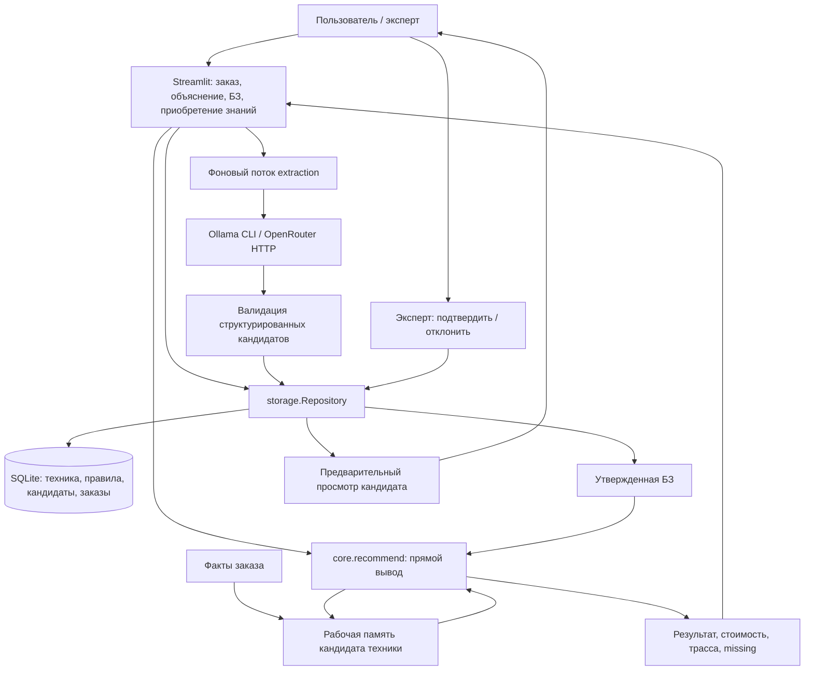

# Архитектура

Соответствие структуре статической ЭС из лекции: долговременные правила и техника находятся в БЗ; исходные и промежуточные факты конкретного подбора — в рабочей памяти ядра; решатель применяет продукционные правила; объяснительный компонент показывает `reasons`, `trace`, `missing`; приобретение знаний проходит через нейросетевых кандидатов и решение эксперта; диалоговый компонент реализован Streamlit.

Публичные точки входа сохранены: `stroytech.ui.main`, `stroytech.storage.Repository`, `stroytech.extraction.extract_rules`, функции `stroytech.validation`. Пакеты группируют модули по ответственности; каждый файл кода содержит не больше 100 строк.

| Каталог / модуль | Ответственность |
| --- | --- |
| `stroytech/ui/` | Формы, результаты, БЗ, фоновые задания, предпросмотр и утверждение правил |
| `stroytech/extraction/` | Конвейер извлечения, Ollama, OpenRouter, схема и проверка кандидатов |
| `stroytech/storage/` | SQLite, начальные данные, миграции и сохранение кандидатов |
| `stroytech/validation/` | Поля правил, валидация, сопоставление и конфликты |
| `stroytech/core.py` | Прямой вывод и подбор техники |
| `stroytech/config.py` | Настройки провайдера, модели и тайм-аута |
| `stroytech/experiments.py` | Запуск и оценка экспериментов |
| `tests/ui/`, `tests/extraction/`, `tests/storage/`, `tests/domain/` | Тесты соответствующих частей приложения |

Вызов модели исполняется в отдельном daemon-потоке без обращения к Streamlit. Поток записывает валидных кандидатов в SQLite отдельным соединением и передает статус через очередь в `st.session_state`. Фрагмент UI проверяет очередь раз в секунду, остальные вкладки доступны. Поля и результаты последнего подбора сохраняются между rerun в текущей сессии; при полном обновлении браузера сессия сбрасывается. SQLite сохраняется независимо от браузерной сессии. Если сервер остановлен до завершения извлечения, результат не гарантируется.

Интерфейсы: `Repository(path).initialize()`, `list_equipment()`, `list_rules()`, `list_candidates()`, `add_candidates(candidates, source_text)`, `approve_candidate(id)`, `reject_candidate(id)`, `save_order(order, results)`. Идентификатор кандидата SQLite — целое число, он отличается от строкового ID правила.

Условия правила соединяются И. Операторы: `eq/ne/in/gt/gte/lt/lte`; последствия: `reject/require/warn/surcharge/fact`. Выводимый факт содержит поле и значение. Конфликт означает несовместимые присваивания факта при пересекающихся условиях; разные рекомендации сами по себе конфликтом не являются. Данные модели не исполняются как код.

Локальный сервер слушает `127.0.0.1`, телеметрия Streamlit отключена. Зависимости закреплены в `requirements.txt` и устанавливаются только в `.venv`. Рабочая БД выбирается через `STROYTECH_DB` либо по умолчанию `data/app.sqlite3`. AppTest обращается к реальному entry point с отдельной временной БД.
