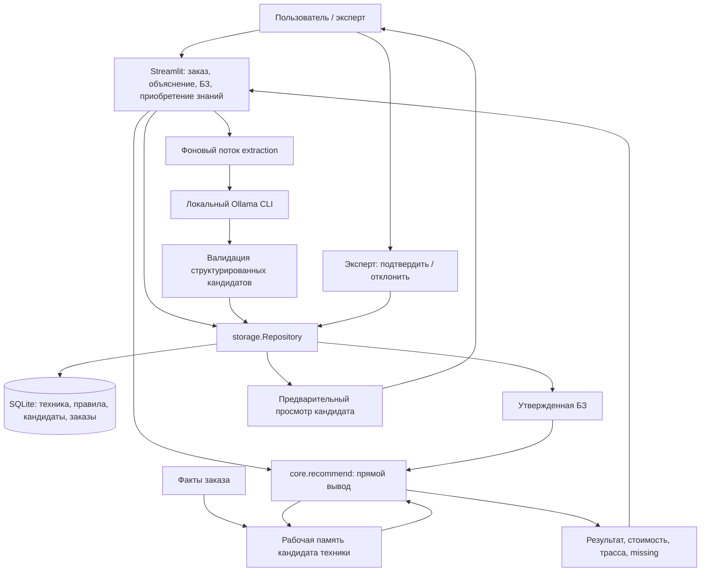

# Архитектура

Соответствие структуре статической ЭС из лекции: долговременные правила и техника находятся в БЗ; исходные и промежуточные факты конкретного подбора — в рабочей памяти ядра; решатель применяет продукционные правила; объяснительный компонент показывает `reasons`, `trace`, `missing`; приобретение знаний проходит через нейросетевых кандидатов и решение эксперта; диалоговый компонент реализован Streamlit.

Публичные точки входа сохранены: `ui.py` содержит `main()` и экспортирует прежние функции интерфейса, `core.py` принимает `order, equipment, rules`, `storage.py` предоставляет `Repository`, `extraction.py` вызывает локальную модель, `validation.py` проверяет правила и конфликты. Реализация разделена на небольшие модули по ответственности.

| Модули | Ответственность |
| --- | --- |
| `ui_labels`, `ui_theme`, `ui_format` | Подписи и стабильные значения, оформление, русское представление фактов и правил |
| `ui_order_data`, `ui_order_actions`, `ui_order` | Разбор заказа, действия с сессией, форма |
| `ui_results`, `ui_knowledge` | Результаты, объяснения и трасса; утверждённые правила и техника |
| `ui_extraction_jobs`, `ui_acquisition` | Фоновое извлечение, очередь статусов, ввод экспертного текста |
| `ui_review_actions`, `ui_candidates` | Подтверждение/отклонение и предпросмотр кандидатов |
| `storage_*` | Соединения и хранение, начальные данные и миграция, кандидаты и утверждение |
| `rule_fields`, `rule_validation`, `rule_matching` | Типы полей, нормализация правил, сопоставление условий и поиск конфликтов |
| `extraction_*` | Запуск Ollama, схема и значения, проверка нейросетевых кандидатов |

Тесты интерфейса разделены аналогично: `test_ui.py` проверяет разбор формы; `test_ui_orders`, `test_ui_review`, `test_ui_acquisition` — сценарии пользователя; `test_ui_support` содержит общий изолированный AppTest-fixture. Вызов модели исполняется в отдельном daemon-потоке без обращения к Streamlit. Поток записывает валидных кандидатов в SQLite отдельным соединением и передает статус через очередь в `st.session_state`. Фрагмент UI проверяет очередь раз в секунду, остальные вкладки доступны. Поля и результаты последнего подбора сохраняются между rerun в текущей сессии; при полном обновлении браузера сессия сбрасывается. SQLite сохраняется независимо от браузерной сессии. Если сервер остановлен до завершения извлечения, результат не гарантируется.

Интерфейсы: `Repository(path).initialize()`, `list_equipment()`, `list_rules()`, `list_candidates()`, `add_candidates(candidates, source_text)`, `approve_candidate(id)`, `reject_candidate(id)`, `save_order(order, results)`. Идентификатор кандидата SQLite — целое число, он отличается от строкового ID правила.

Условия правила соединяются И. Операторы: `eq/ne/in/gt/gte/lt/lte`; последствия: `reject/require/warn/surcharge/fact`. Выводимый факт содержит поле и значение. Конфликт означает несовместимые присваивания факта при пересекающихся условиях; разные рекомендации сами по себе конфликтом не являются. Данные модели не исполняются как код.

Локальный сервер слушает `127.0.0.1`, телеметрия Streamlit отключена. Зависимости закреплены в `requirements.txt` и устанавливаются только в `.venv`. Рабочая БД выбирается через `STROYTECH_DB` либо по умолчанию `data/app.sqlite3`. AppTest обращается к реальному entry point с отдельной временной БД.
